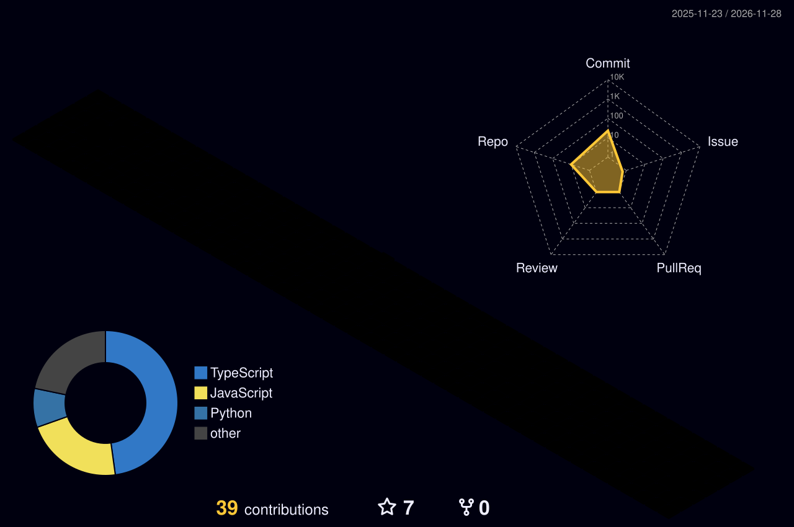

<div align="center">


[](https://git.io/typing-svg)

<a href="https://www.linkedin.com/in/aman-cve-7773631a6/"></a>


</div>

## 🚀 About me

```python
class Aman:
    def __init__(self):
        self.role        = "ML / Quant Engineer"
        self.work        = "QMA @ Outlier — improving GPT-4, Claude & DeepSeek outputs"
        self.education   = "B.E. (ML/Data), Chandigarh University · final year"
        self.focus       = ["LLM evaluation", "Explainable AI", "Quant research"]
        self.achievement = "🥈 2nd place, HackTheFest"
        self.motto       = "Ship in a weekend what teams plan for a month."

    def currently(self):
        return "Turning AI prototypes into things that actually work at scale"
```

- 🔭 **Working on** → [`quant-alpha`](https://github.com/Aman-cve/quant-alpha), a multi-strategy quant backtesting engine on real US & Indian market data
- 🧠 **Research** → explainable AI for **Parkinson's detection from MRI** (the *why*, not just the score)
- 💼 **Day job** → quality analysis & improvement of frontier **LLM** outputs at **Outlier**
- 🎯 **Open to** → ML / AI / quant engineering roles · also prepping **GATE DA**

<br/>

## 🛠️ Tech stack

<div align="center">


</div>

<br/>

## 📌 Featured projects

<table>
<tr>
<td width="50%" valign="top">

### ⚡ [quant-alpha](https://github.com/Aman-cve/quant-alpha)
Multi-strategy **quant backtesting engine** for US & Indian equities. Momentum, stat-arb pairs, trend & mean-reversion on real market data — cost-aware, no look-ahead, pure Python + NumPy.


> **Sharpe 1.10** · −3.5% max DD on NSE momentum

</td>
<td width="50%" valign="top">

### 🧠 pd-xai · *in progress*
Explainable AI for **Parkinson's detection from MRI** — pairing CNN predictions with interpretability so clinicians see *why*, not just a score.


> Trustworthy, interpretable diagnosis

</td>
</tr>
</table>

<br/>

## 📊 Analytics

<div align="center">


</div>

<br/>

## 🏆 Trophies

<div align="center">


</div>

<br/>

## 🧊 3D contribution graph

<div align="center">



</div>

<br/>

## 🐍 Watch my contributions get eaten

<div align="center">


</div>

<br/>

<div align="center">

### 💬 Let's build something that ships

<a href="https://www.linkedin.com/in/aman-cve-7773631a6/"></a>

<sub><i>"Not your typical engineer — I win by shipping."</i></sub>


</div>
